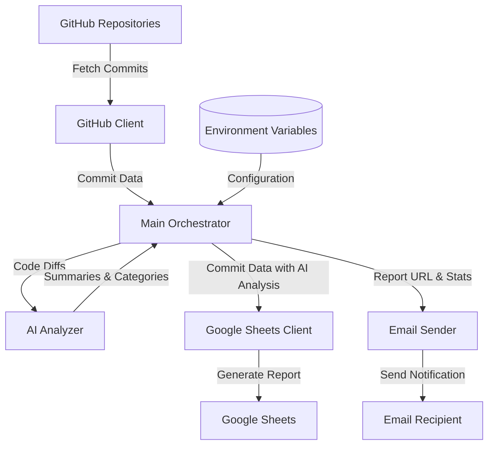
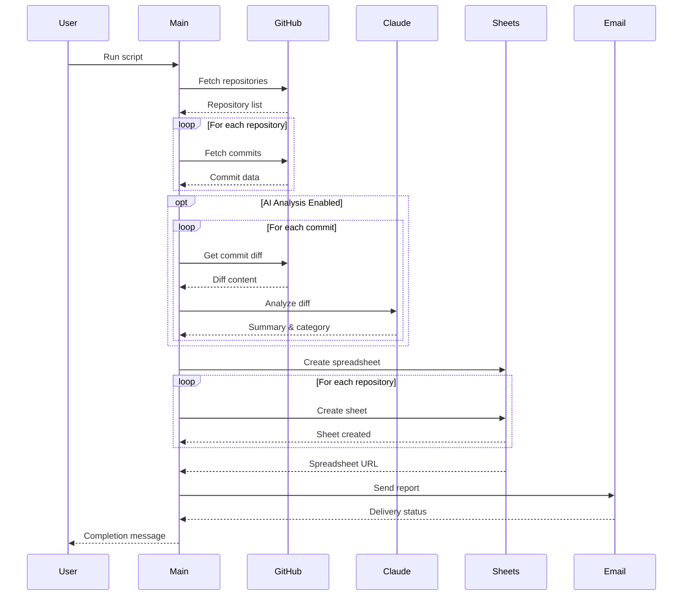

# GitHub Commit Tracking Automation

An automated system for collecting, analyzing, and reporting GitHub commits across specified repositories. This tool uses Claude AI to provide intelligent summaries of code changes and automatically generates monthly reports in Google Sheets.

## Table of Contents
- [Features](#features)
- [System Architecture](#system-architecture)
- [Prerequisites](#prerequisites)
- [Installation](#installation)
- [Configuration](#configuration)
- [Usage](#usage)
- [Testing](#testing)
- [Project Structure](#project-structure)
- [AI Analysis](#ai-analysis)
- [Flow Diagrams](#flow-diagrams)
- [Troubleshooting](#troubleshooting)

## Features

- **Automated Data Collection**: Fetch commits from multiple GitHub repositories within a specified date range
- **AI-Powered Analysis**: Use Claude API to generate human-readable summaries of technical code changes
- **Intelligent Categorization**: Automatically categorize commits by change type (Feature, Bug Fix, etc.)
- **Report Generation**: Create professional CSV reports and AI summaries
- **Repository Organization**: Group commits by repository with separate reports for each
- **WhatsApp Integration**: Send reports and AI summaries to WhatsApp Business groups
- **Email Delivery**: Send reports automatically with summary statistics (optional)
- **Cost Management**: Track and optimize Claude API usage to stay within budget

## System Architecture

The system consists of six main components:

1. **GitHub Client**: Interfaces with GitHub API to fetch repository and commit data
2. **AI Analyzer**: Uses Claude API to analyze commit diffs and generate summaries
3. **CSV Reporter**: Generates detailed CSV reports for all repositories
4. **WhatsApp Sender**: Delivers reports to WhatsApp Business groups (optional)
5. **Email Sender**: Delivers reports to specified recipients (optional)
6. **Main Orchestrator**: Coordinates the entire workflow

## Prerequisites

- Python 3.8 or higher
- GitHub Personal Access Token
- Claude API key (from Anthropic)
- **WhatsApp Business Account** (optional, for WhatsApp notifications)
- **Meta Developer Account** (optional, for WhatsApp API access)
- Google Cloud project with Sheets API enabled (optional)
- Google Service Account with appropriate permissions (optional)
- Email account for sending notifications (optional)

## Installation

1. Clone the repository:

```bash
git clone <repository-url>
cd task-sheet-automation
```

2. Install required dependencies:

```bash
pip install -r requirements.txt
```

3. Set up environment variables:

```bash
cp .env.example .env
# Edit .env file with your credentials
```

4. Set up Google Sheets API:
   - Create a Google Cloud project
   - Enable Google Sheets API
   - Create a service account
   - Download the JSON credentials file
   - Place the credentials file in your project directory (default: `credentials.json`)

## Configuration

Configuration is handled through environment variables or a `.env` file:

### Essential Settings

- `GITHUB_TOKEN`: Your GitHub Personal Access Token
- `GITHUB_REPOS`: Comma-separated list of repositories to monitor (e.g., `owner/repo,owner2/repo2`)
- `CLAUDE_API_KEY`: Your Claude API key
- `GOOGLE_CREDENTIALS_FILE`: Path to Google API credentials JSON file
- `EMAIL_SENDER`, `EMAIL_PASSWORD`: Credentials for sending email notifications
- `EMAIL_RECIPIENT`: Where to send reports (default: `recipient@example.com`)

### Optional Settings

- `CLAUDE_MODEL`: Claude model to use (default: `claude-3-5-sonnet-20241022`)
- `AI_ENABLED`: Enable/disable AI analysis (default: `True`)
- `AI_BUDGET_LIMIT`: Maximum monthly budget for Claude API usage (default: `$50.00`)
- `PARALLEL_PROCESSING`: Enable/disable parallel processing for AI analysis (default: `True`)
- `MAX_WORKERS`: Number of worker threads for parallel processing (default: `5`)

### WhatsApp Business API Settings (Optional)

- `WHATSAPP_ENABLED`: Enable/disable WhatsApp notifications (default: `False`)
- `WHATSAPP_ACCESS_TOKEN`: Meta WhatsApp Business API access token
- `WHATSAPP_PHONE_NUMBER_ID`: WhatsApp Business phone number ID
- `WHATSAPP_BUSINESS_ACCOUNT_ID`: WhatsApp Business Account ID
- `WHATSAPP_GROUP_IDS`: Comma-separated list of recipient IDs (phone numbers or group IDs)

**For detailed WhatsApp setup instructions, see [WHATSAPP_SETUP.md](WHATSAPP_SETUP.md)**

See `.env.example` for all available configuration options.

## Usage

### Basic Usage

Run the script to generate a report for the current month:

```bash
python main.py
```

### Custom Date Range

Specify a different month:

```bash
python main.py --month 2024-05
```

### Specific Repositories

Process only certain repositories:

```bash
python main.py --repos owner/repo1,owner/repo2
```

### Custom Email Recipient

Send the report to a different email:

```bash
python main.py --email recipient@example.com
```

### Disable AI Analysis

Run without Claude AI analysis:

```bash
python main.py --no-ai
```

### Verbose Output

Show detailed logging during execution:

```bash
python main.py --verbose
```

## Testing

To run tests:

```bash
# Test with minimal repositories and no AI to verify setup
python main.py --repos owner/small-repo --no-ai

# Test rate limiting and error handling
python main.py --repos owner/large-repo
```

## Project Structure

```
task-sheet-automation/
├── main.py                 # Main orchestration script
├── github_client.py        # GitHub API integration
├── ai_analyzer.py          # Claude API integration
├── google_sheets.py        # Google Sheets integration
├── email_sender.py         # Email notification module
├── config.py               # Configuration management
├── requirements.txt        # Python dependencies
├── .env.example            # Environment variable template
├── README.md               # Project documentation
└── credentials.json        # Google API credentials (not in repo)
```

## AI Analysis

The AI analysis feature uses Claude to:

1. **Analyze Code Changes**: Process diffs to understand what was modified
2. **Generate Summaries**: Create concise explanations of technical changes
3. **Categorize Changes**: Classify commits into predefined categories

### Change Categories

- **Feature**: New functionality or capability
- **Bug Fix**: Correcting existing issues
- **Refactor**: Code restructuring without changing functionality
- **Performance**: Optimization improvements
- **Security**: Security-related changes
- **Documentation**: Documentation updates
- **Configuration**: Config/setup changes
- **Dependencies**: Library or package updates
- **Database**: Database schema or migration changes
- **UI/UX**: User interface improvements
- **Test**: Testing-related changes
- **Build/Deploy**: Build system or deployment changes
- **Other**: Miscellaneous changes

## Flow Diagrams

### System Architecture



### Processing Workflow



## Troubleshooting

### Common Issues

1. **API Rate Limiting**
   - **Symptom**: Script fails with rate limit errors
   - **Solution**: Reduce parallel workers or increase delay between requests

2. **Authentication Failures**
   - **Symptom**: "Unauthorized" errors
   - **Solution**: Check API keys and credentials in `.env` file

3. **Large Repository Performance**
   - **Symptom**: Script takes too long or times out
   - **Solution**: Use date range filtering or process repositories separately

4. **AI Analysis Budget**
   - **Symptom**: AI analysis stops before completion
   - **Solution**: Increase budget limit or run with `--no-ai` flag

5. **Email Delivery Issues**
   - **Symptom**: Email not received
   - **Solution**: Check SMTP settings and enable "Less secure apps" for Google accounts

### Logging

Logs are stored in `commit_tracker.log` by default. Use `--verbose` flag to see logs in console output.

## License

This project is licensed under the MIT License - see the LICENSE file for details.
